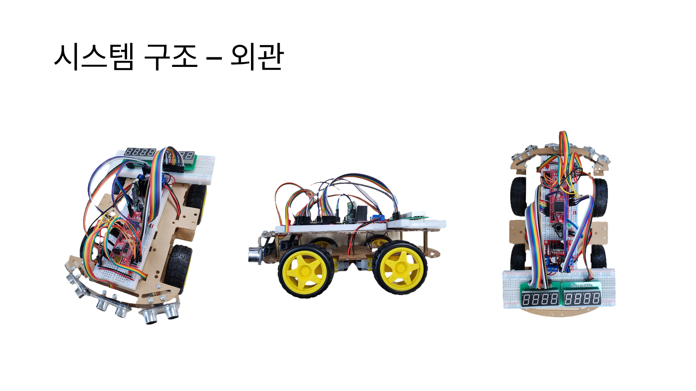
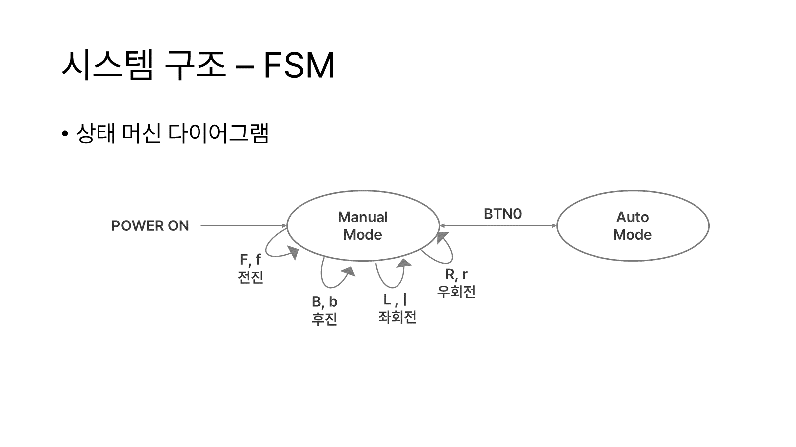

# 초음파 센서 기반 자율주행 자동차 (ATmega128A)

초음파 센서 3개로 장애물을 피하며 주행하는 **자동 모드**와 블루투스로 조종하는 **수동 모드**를 갖춘 RC카. 주행 시간, 후진·좌회전·우회전 횟수 FND 표시.

- **기간**: 2026-06-22 ~ 06-25
- **MCU**: ATmega128A · **언어**: C
- **형태**: 개인 프로젝트
- **발표 자료**: [PDF](docs/presentation.pdf)



## 시스템 구성

| 부품 | 용도 |
|---|---|
| ATmega128A | 메인 MCU |
| L298N + DC 모터 4개 | 구동부 (Timer1 PWM으로 좌우 속도 제어) |
| HC-SR04 × 3 | 좌 / 전방 / 우 거리 측정 (외부 인터럽트 INT4~6 + Timer3 카운터) |
| HC-06 (블루투스) | 스마트폰 원격 조종 (UART1) |
| FND × 2, LED, 버튼 | 주행 통계 표시, 모드 전환 |

## 동작 방식



- **수동 모드**
  - 블루투스 문자 명령: `F`(전진) `B`(후진) `L`(좌) `R`(우) `S`(정지)
  - 좌우 회전: 한쪽 바퀴 PWM을 0으로 설정
- **자동 모드**
  - 전방 거리가 가까우면 더 넓은 쪽으로 회전
  - 좌우 거리 차이가 크면 `error × 7`만큼 좌우 PWM 보정, 벽과 일정 거리 유지
  - 세 방향 모두 막히면 정지
  - `S` / `F` 문자로 자동 주행 일시정지·재개
- **FND**
  - 총 주행 시간(초), 후진 횟수, 좌회전 횟수, 우회전 횟수 표시
  - 같은 회전 동작 중에는 한 번만 세도록 중복 카운트 방지
- **센서 측정**
  - 세 센서를 60ms 간격으로 하나씩 순환 측정, 센서 간 간섭 방지
  - 에코 펄스 폭을 INT4~6 인터럽트와 Timer3 카운터로 측정 → 거리(cm) 환산
- **거리 모니터링**: 세 방향 거리(`L:xx F:xx R:xx`) 블루투스 전송 (`BT_print_distance`)

## 코드 구조

```
src/
├── main.c        초기화, 메인 루프, Timer0 1ms 인터럽트
├── common.h      자동차 상태 구조체 (모드, 센서 3개, 주행 카운터)
├── drive.c       수동/자동 주행 로직
├── motor.c       L298N 방향 제어, PWM 출력
├── ultrasonic.c  트리거 순환, 에코 폭 측정 → 거리 계산
├── button.c      모드 전환 버튼
├── fnd.c         주행 통계 FND 표시
├── uart0.c       디버그 출력
└── uart1.c       블루투스 수신 (bt_data)
docs/             발표 자료(PDF), 슬라이드 이미지
```

## 빌드

- Microchip Studio: `src/Auto_Car_FND.cproj` 열어서 빌드
- avr-gcc:

```bash
avr-gcc -mmcu=atmega128a -Os -I src -o autocar.elf src/*.c
```

## 개발 경과

- 6/24 발표 시점: FND 표시 미완성
- 6/25: FND 주행 통계 표시 추가, 완성

## 트러블슈팅

- 버튼 미동작: 오실로스코프로 회로 결선 오류 확인 후 수정
- 초음파 센서 데이터 노이즈 확인 → 값 전처리 필요성 확인
